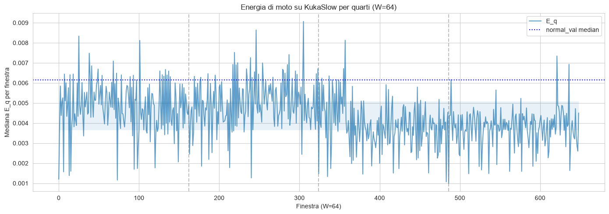
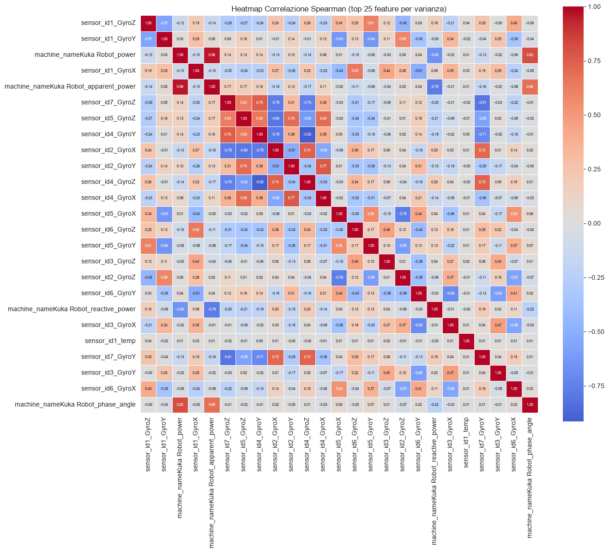
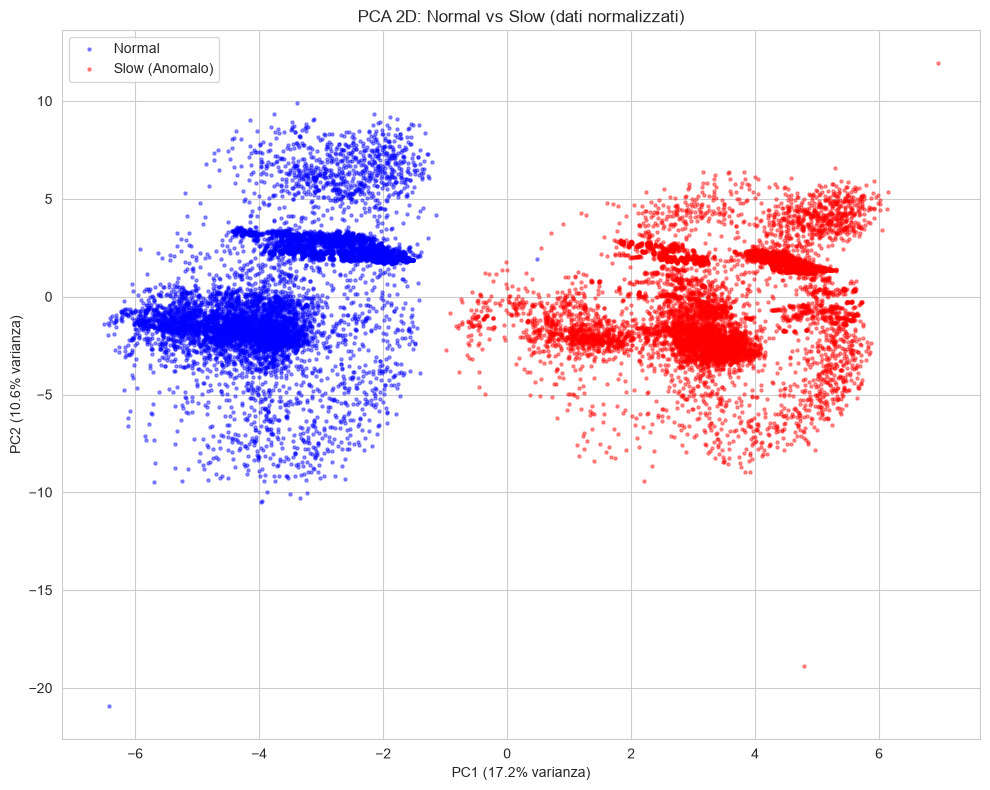
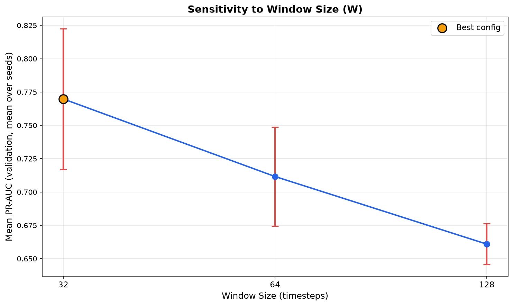
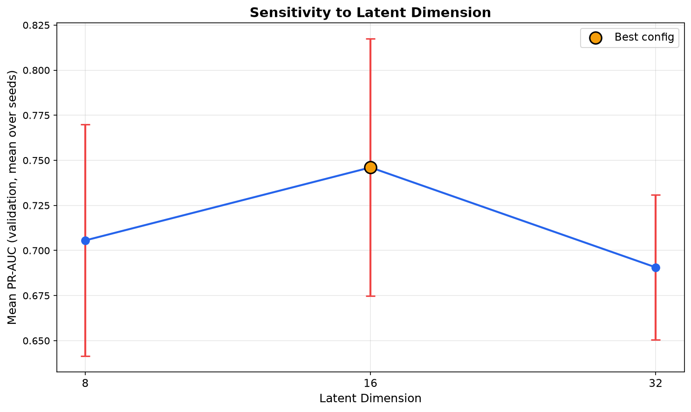
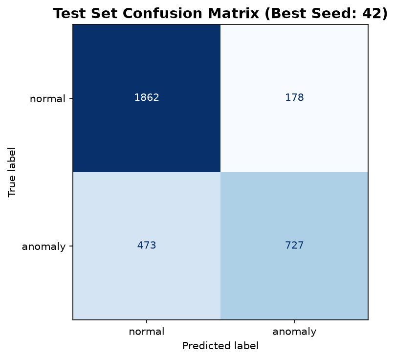
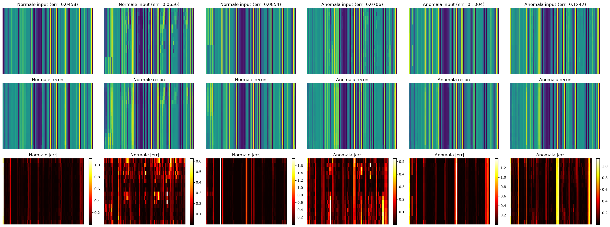
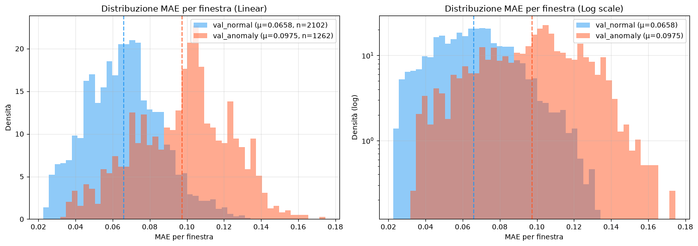

# Documentazione Tecnica — AM01: Detection of Anomalous Behaviour in Industrial Robot

Questo documento descrive l'intero progetto di Machine Learning per la rilevazione di comportamenti anomali in un robot industriale Kuka. 

Il progetto si occupa di individuare quando un robot industriale Kuka si comporta in modo anomalo — ad esempio si muove più lentamente o con meno precisione del normale — a causa di errori di configurazione o usura meccanica. L'approccio da usare è quello dell'autoencoder: un modello di rete neurale impara a ricostruire i movimenti normali del robot; in fase di inferenza, se l'errore di ricostruzione è elevato, l'input viene classificato come anomalia.

L'obiettivo di ricerca è valutare se una componente avversariale (Adversarial Autoencoder, AAE) migliora le prestazioni rispetto a un autoencoder tradizionale. Alla data di questo documento, l'autoencoder (AE) è completamente implementato, addestrato e valutato. L'AAE non è ancora stato implementato: i file `src/models/adversarial_ae.py` e `src/models/compare_models.py` contengono solo docstring, senza classi né funzioni. Di conseguenza, tutte le sezioni che riguardano l'AAE sono presentate come placeholder vuoti.

Il dataset utilizzato è il Kuka Velocity Dataset, composto da tre file `.npy` in `data/raw/`:
- `KukaNormal.npy`: 233.792 campioni × 86 feature, movimento normale.
- `KukaSlow.npy`: 41.538 campioni × 87 colonne, movimento lento/anomalo. La 87ª colonna è una label binaria (`anomaly`, sempre 1) che marca la classe anomala; non è una feature e viene rimossa.
- `KukaColumnNames.npy`: 87 nomi di colonna.

Lo stack tecnologico è Python, PyTorch, scikit-learn, `uv` per le dipendenze, e SLURM sul cluster PoliTO Legion per l'esecuzione su GPU.

---

## 1. EDA — Exploratory Data Analysis

L'analisi esplorativa è stata la prima fase. Il suo scopo era comprendere struttura, distribuzione e proprietà temporali dei dati prima di scrivere codice di produzione. Tutti i grafici citati sono stati generati dal notebook `notebooks/01_data_exploration.ipynb` e salvati in `../reports/figures/`.

### Caricamento e struttura dei dati

I tre file `.npy` sono stati caricati e verificati per shape e dtype. `KukaNormal` ha 86 colonne, `KukaSlow` ne ha 87. L'extra colonna di `KukaSlow` è stata identificata come `anomaly`, una label binaria costantemente pari a 1. Non rappresenta una misura del sensore, ma l'etichetta della classe. Includerla nel modello significherebbe fornire direttamente la risposta (data leakage), quindi è stata scartata durante il preprocessing, allineando entrambe le matrici a 86 feature.

### Distribuzioni Normal vs Slow

Le distribuzioni delle singole feature sono state confrontate tra `KukaNormal` e `KukaSlow`. Nella figura seguente si osserva l'energia di moto su KukaSlow per quarti di finestra, che evidenzia come il movimento lento presenti pattern energetici diversi dal normale:



La linea blu (`E_q`) oscilla per gran parte **sotto** la linea punteggiata blu (`normal_val_median` ≈ 0,0062), confermando che i movimenti slow sono meno energetici del normale. Questo è un segnale fisico atteso: un robot che si muove più lentamente sviluppa minore energia cinetica per finestra, e il modello deve imparare a riconoscerlo come anomalia attraverso l'errore di ricostruzione.
Alcune feature mostrano spostamenti visibili di distribuzione tra le due classi, il che suggerisce che il movimento lento lascia tracce misurabili su più sensori contemporaneamente. 

### Correlazioni (heatmap Spearman)

È stata calcolata la matrice di correlazione di Spearman tra tutte le feature, visualizzata come heatmap sulle 25 feature con varianza maggiore:



L'heatmap mostra blocchi di sensori fortemente correlati tra loro (ad esempio i tre assi del giroscopio e dell'accelerometro), il che era atteso dato che misurano grandezze fisiche correlate. Non è emersa una singola feature così dominante da giustificarne la rimozione a scapito delle altre: le correlazioni sono distribuite su blocchi omogenei, non concentrate su una variabile unica. Per questo è stata mantenuta l'intera serie di 86 feature senza procedere con un feature selection.

### PCA e separabilità delle classi

Sono stati eseguiti PCA e t-SNE in due dimensioni per verificare se le classi (normale vs lento) sono visibilmente separabili. La figura seguente mostra il risultato della PCA 2D:



Il grafico mostra due nuvole chiaramente separate: i punti normali (blu) concentrati a sinistra con PC1 negativo, i punti slow/anomali (rossi) concentrati a destra con PC1 positivo. PC1 spiega il 17,2% della varianza, PC2 il 10,6%.

Tuttavia questo risultato va interpretato con cautela. La PCA è stata calcolata sui primi 10.000 campioni normali, che costituiscono un blocco contiguo all'inizio della registrazione. Per verificare che la separazione non fosse un artefatto di questo blocco iniziale (ad esempio dovuto a fase di avviamento o riscaldamento dei motori), il notebook rifà la PCA su un campione casuale di 10.000 campioni normali. Il risultato è il seguente:

- Occorrono **28 componenti principali** per spiegare il 90% della varianza, **35** per il 95% e **50** per il 99%: i dati sono intrinsecamente ad alta dimensionalità e non si riducono a poche direzioni lineari.
- Il ROC-AUC di PC1 sul blocco iniziale è **1.0**, ma su campione casuale scende a **0,5222**, vicinissimo al classificatore casuale (0,5). Le altre PC (PC2, PC3) hanno ROC-AUC intorno a 0,40.

In altre parole, la separazione visibile nel grafico PCA 2D era un artefatto dell'ordine temporale dei primi campioni, non una reale separabilità tra normale e anomalo. Questa analisi non è inutile: esclude la strada di una separazione lineare su poche componenti principali e giustifica la scelta di un modello che impari la distribuzione complessa del comportamento normale (l'autoencoder), anziché affidarsi a proiezioni lineari semplici o a classificatori basati su singole direzioni di massima varianza.

### t-SNE e struttura non lineare

È stato eseguito t-SNE 2D su 5.000 campioni (perplessità 30) per catturare strutture non lineari che la PCA, essendo lineare, potrebbe non evidenziare. Se PCA mostrava sovrapposizione ma t-SNE separava, il problema sarebbe stato da considerare non lineare, a favore di modelli come i Conv1D o gli autoencoder. Questo ha rafforzato la scelta di un modello capace di imparare pattern complessi piuttosto che un classificatore lineare semplice.

### Ordinamento temporale e split

I file `.npy` non contengono timestamp espliciti: l'indice di riga corrisponde all'ordine temporale di acquisizione. L'autocorrelazione al lag-1 — la correlazione tra ogni valore e il valore del timestep immediatamente precedente — è risultata superiore a 0,99 su tutte le feature. Questo conferma che i dati costituiscono una sessione continua e regolare, dove campioni adiacenti nel tempo sono quasi identici.

Da questa osservazione derivano due decisioni ingegneristiche:

1. **Nessuno shuffle dei campioni:** non si mescolano i campioni singolarmente a caso, perché romperebbe la continuità temporale e introdurrebbe data leakage (il modello vedrebbe informazioni del "futuro" durante l'addestramento).

2. **Split temporale con partizionamento interleaved:** i dati sono stati divisi secondo uno split temporale, ma le partizioni non sono assegnate in blocchi contigui (primo 70% train, successivo 15% val, ultimo 15% test). Questa scelta è stata dettata dal **drift temporale**: le proprietà statistiche dei dati cambiano nel tempo (ad esempio per riscaldamento dei motori o usura progressiva), quindi assegnare a train solo la prima parte e a test solo l'ultima renderebbe le metriche di validation non rappresentative della performance reale. Il partizionamento interleaved distribuisce i blocchi di dati di ogni partizione lungo l'intera arco temporale, evitando che una partizione veda solo una "fase" del robot.

Il funzionamento dettagliato del partizionamento interleaved (algoritmo di assegnamento dei chunk, guard band, verifica R2a/R2b) è descritto nella sezione Preprocessing.

Alcune esplorazioni iniziali (es. selezione di feature basata solo su correlazione elevata) sono state avviate ma non hanno portato a modifiche nel codice di produzione: sono servite a escludere strade non promettenti.

---

## 2. Preprocessing & Feature Engineering & Split dei Dati

Il preprocessing trasforma i dati grezzi in un formato adatto all'addestramento, garantendo assenza di data leakage tra train, validation e test.

### Caricamento e allineamento

Le due registrazioni vengono caricate e allineate: da `KukaSlow` viene rimossa la colonna `anomaly` (87→86 colonne). Le due matrici vengono così portate allo stesso numero di feature. In fase di esplorazione erano state identificate quattro feature costanti (deviazione standard prossima a zero), ma nel codice di produzione finale l'input_dim resta 86: nessuna feature è stata effettivamente scartata, poiché la decisione finale è stata di mantenere tutte le misure e lasciare al modello il compito di filtrare ciò che non è informativo.

### MinMaxScaler: come funziona nel concreto

La normalizzazione utilizzata è `MinMaxScaler` con intervallo di target `[-1, 1]`. Per ogni feature, lo scaler applica la trasformazione:

```
x_scaled = (x - min) / (max - min) * 2 - 1
```

dove `min` e `max` sono il minimo e il massimo calcolati **esclusivamente sulle righe del training set**. Lo scaler viene fittingato solo sui dati di train: le statistiche di normalizzazione non derivano mai da validation o test. Questo è fondamentale per evitare data leakage: se lo scaler vedesse anche i dati di test, le informazioni sul range globale influenzerebbero indirettamente il modello.

Spezzone di codice fedele da `src/data/preprocessing.py`:

```python
scaler = MinMaxScaler(feature_range=(-1, 1))
scaler.fit(train_rows)

normal_scaled = scaler.transform(normal).astype(np.float32)
slow_scaled = scaler.transform(slow).astype(np.float32)
```

### Clipping: come è fatto e perché è ragionevole

È stato attivato il clipping (`clip_out_of_range: true`): dopo lo scaling, i valori inferiori a -1 vengono portati a -1 e i valori superiori a 1 vengono portati a 1, tramite `np.clip(arr, -1.0, 1.0)`.

#### Drift vs spike

Per capire la scelta, bisogna distinguere due tipi di anomalia nei dati dei sensori:

- **Spike:** un'alterazione improvvisa e localizzata (un singolo timestep o pochi timestep con un valore molto diverso dai vicini). Gli spike sono tipici di guasti elettrici, urti o interferenze elettromagnetiche.
- **Drift:** una variazione lenta e prolungata nel tempo di una o più feature. Il movimento "slow" del robot (registrazione `KukaSlow`) è caratterizzato proprio da questo: il robot si muove più lentamente o con meno precisione, producendo derive graduali nei segnali dei sensori invece che picchi improvvisi.

Il motivo per cui i dati lenti sono classificati come drift e non spike deriva dalla natura fisica della registrazione: `KukaSlow` documenta movimenti rallentati del robot, quindi le deviazioni dal normale si manifestano come deviazioni sostenute nel tempo, non come impulsi brevi.

#### Perché clippare a [-1, 1] dopo MinMaxScaler

Dopo il fitting di `MinMaxScaler(feature_range=(-1, 1))` solo sulle righe di train, i dati di validation e test possono uscire dall'intervallo `[-1, 1]` per drift distribuito: è un comportamento previsto e segnalato come avviso nel codice, non un errore. Questi valori fuori range corrispondono in molti casi a **saturazione hardware dei sensori** (ad esempio giroscopio ±2000, accelerometro ±16): il sensore non può restituire valori oltre un certo limite, quindi "appiattisce" il segnale al massimo rilevabile.

Questi valori saturati sono artefatti fisici del sensore, non anomalie da rilevare. Includerli tali quali nel training dell'autoencoder rischierebbe di:
1. **Distorcere la ricostruzione:** il modello cercherebbe di ricostruire esattamente valori che sono già al limite fisico del sensore, sprecando capacità rappresentativa su artefatti invece che sul pattern di comportamento normale.
2. **Sovrastimare gli errori con MSE:** se si usasse MSE, gli errori al quadrato su valori saturati sarebbero eccessivi (motivo per cui si usa MAE, vedi sezione Training).

Il clipping limita l'impatto di questi valori estremi sul training senza rischiare di nascondere pattern utili: non si perde informazione sul comportamento normale, perché i valori saturati non rappresentano comportamenti normali significativi da ricostruire. Si "appiattisce" solo ciò che il sensore non è in grado di misurare oltre un certo punto.

Spezzone di codice fedele da `src/data/preprocessing.py`:

```python
if clip_out_of_range:
    normal_scaled = np.clip(normal_scaled, -1.0, 1.0)
    slow_scaled = np.clip(slow_scaled, -1.0, 1.0)
```

In sintesi: il clipping agisce come un filtro di sicurezza sui valori di saturazione hardware, lasciando intatti tutti i valori nell'intervallo misurabile dal sensore. Il modello impara a ricostruire il comportamento normale entro quel range, e in inferenza un errore di ricostruzione elevato su una finestra segnala che il comportamento si è discostato dal normale — tipicamente per un drift lento, che è esattamente ciò che il progetto vuole rilevare. Clippando si evita di sprecare la capacità rappresentativa del modello per artefatti hardware che non permetterebbero di identificare le anomalie. 

### Split temporale e partizioni

I dati vengono divisi secondo uno split temporale, senza shuffle. `KukaNormal` è suddiviso in 70% training, 15% validation normale (`val_normal`) e 15% test normale (`test_normal`). `KukaSlow` è suddiviso in 50% validation anomalia (`val_anomaly`) e 50% test anomalia (`test_anomaly`). Il training vede solo dati normali: l'autoencoder impara la distribuzione del comportamento normale, e in inferenza un'alta errore di ricostruzione segnala un'anomalia. Mescolare anomali nel training "avvelenerebbe" il modello, insegnandogli a ricostruire anche il comportamento anomalo.

### Interleaved partitioning: come funziona

Le partizioni non sono salvate su disco come file finestra per finestra. Su `data/processed/` sono presenti solo le registrazioni complete scalate (`normal_scaled.npy`, `slow_scaled.npy`), lo scaler serializzato (`scaler.pkl`), i nomi delle colonne selezionate (`selected_columns.npy`) e due file di metadati (`manifest.json`, `stats.json`). Le finestre vengono estratte **al volo** durante l'addestramento e la valutazione dalla classe `KukaDataset`, che riceve gli indici di inizio di ogni finestra e restituisce il sottovettore corrispondente tramite slicing.

Questo approccio on-the-fly evita di occupare gigabyte di spazio su disco: pre-computare tutte le finestre richiederebbe centinaia di megabyte (decine di migliaia di finestre × 32 timestep × 86 feature × 4 byte), mentre con l'estrazione al volo si memorizzano solo le due registrazioni intere (~0,18 GB complessivi vs ~2,9 GB se pre-computate). Inoltre, ricomputando il piano di partizione per ogni valore di `window_size`, è possibile esplorare diverse dimensioni di finestra senza dover rieseguire l'intero pipeline di preprocessing.

Il piano di partizione utilizza la modalità **interleaved** con `chunk_size: 1024` e una guard band pari alla dimensione della finestra (`gap: window`). I dati vengono divisi in blocchi di 1024 campioni, e ciascun blocco viene assegnato a una partizione (train, val_normal, test_normal, val_anomaly, test_anomaly) in modo sparso lungo la timeline, non in blocchi contigui. Tra blocchi di partizioni diverse viene inserita una zona di sicurezza pari a una finestra intera, in modo che nessuna finestra di una partizione sovrapponga o sia troppo vicina a una finestra di un'altra partizione.

Disegno schematico del partizionamento interleaved:

```
Timeline:  [ chunk 0 ] [ chunk 1 ] [ chunk 2 ] [ chunk 3 ] [ chunk 4 ] ...
           |  train  |  val_n  |  train  |  test_n |  val_n  | ...
             ^         ^         ^         ^         ^
             |         |         |         |         |
         guard W     guard W   guard W   guard W   guard W
```

Ogni partizione riceve blocchi distribuiti sull'intero arco temporale, quindi il modello vede comportamenti normali provenienti da tempi diversi. La funzione `assign_chunks_spread` usa un algoritmo simile a Bresenham (largest-deficit) per distribuire i chunk in modo uniforme rispettando le quote esatte definite in config.

Spezzone di codice fedele da `src/data/partitioning.py`:

```python
def assign_chunks_spread(n_chunks: int, quotas: list[float]) -> np.ndarray:
    quotas = np.asarray(quotas, dtype=float)
    counts = _exact_counts(n_chunks, quotas)
    owner = np.empty(n_chunks, dtype=np.int64)
    assigned = np.zeros(len(quotas), dtype=int)
    remaining = counts.copy()

    for c in range(n_chunks):
        deficit = (c + 1) * quotas - assigned
        deficit[remaining == 0] = -np.inf
        p = int(np.argmax(deficit))
        owner[c] = p
        assigned[p] += 1
        remaining[p] -= 1

    return owner
```

### Perché chronological è stato scartato

È stata implementata anche la modalità `chronological` (assegnazione di blocchi in sequenza contigua: primi blocchi a train, successivi a validation, ultimi a test), equivalente a uno split temporale classico. È stata scartata a causa del **drift temporale** nei dati.

Il drift è il fenomeno per cui le proprietà statistiche dei dati cambiano nel tempo. In questo dataset, la prima metà della registrazione normale può essere sistematicamente più difficile da ricostruire della seconda (o viceversa), ad esempio a causa di riscaldamento dei motori, usura progressiva o cambiamenti di carico. Con uno split chronologico, il training vedrebbe solo la prima parte e il test solo la seconda: le metriche di validazione sarebbero negativamente influenzate (modello non esposto alle condizioni di test), mentre i risultati sul test sarebbero artificialmente positivi o negativi a seconda della direzione del drift. L'interleaved distribuisce ogni partizione su tutta la timeline, rendendo il modello più robusto a variazioni del comportamento normale nel tempo e le metriche di validation più rappresentative della performance reale.

### Stride e verifica di assenza di leakage

Lo stride (distanza tra finestre consecutive all'interno di una stessa partizione) varia in base alla partizione: per il training è pari a 0,25 volte la dimensione della finestra (finestre più ravvicinate, più campioni di training), mentre per validation e test è pari a 0,5 volte la finestra.

La funzione `verify_no_leakage` controlla formalmente due proprietà:
- **R2a (disjointness)**: nessun campione è condiviso tra partizioni diverse.
- **R2b (temporal gap)**: tra due finestre di partizioni diverse c'è un gap di almeno una finestra intera (`gap >= W`).

Spezzone di codice fedele da `src/data/partitioning.py`:

```python
def verify_no_leakage(starts_by_partition, window_size, gap):
    all_starts = []
    all_ends = []
    all_labels = []
    for label, starts in starts_by_partition.items():
        if len(starts) == 0:
            continue
        all_starts.append(starts)
        all_ends.append(starts + window_size)
        all_labels.extend([label] * len(starts))
    ...
    # R2a: no sample shared between different partitions
    # R2b: gap >= gap between different partitions
```

### Le partizioni non sono file su disco

Va chiarito un punto importante: non si trovano file finestra già pronti in `data/processed/`. Non esistono dataset finestrati salvati su disco per train, val o test. Le partizioni esistono solo come **piani di indici** (array di interi che indicano da dove inizia ogni finestra), calcolati in memoria dal modulo `partitioning` e usati al volo da `KukaDataset`. Questo è esattamente ciò che permette il calcolo al volo e il cambio rapido di `window_size` senza rieseguire il preprocessing.

---

## 3. Validation Strategy

La validazione degli iperparametri è organizzata in tre stadi separati e sequenziali, ciascuno con un ruolo preciso, per evitare ogni forma di data leakage.

### 3.1 Stage 1 — Selezione degli iperparametri (grid search)

Il primo stadio è una grid search (ricerca esaustiva su griglia) sullo spazio degli iperparametri dell'autoencoder. Per ogni combinazione di `window_size` e `latent_dim` definita nella griglia, il modello viene addestrato sul training set con early stopping basato sulla loss di ricostruzione su `val_normal`. Al termine di ogni run, vengono calcolate le metriche **threshold-free** ROC-AUC e PR-AUC sul set di validation composto da `val_normal` (label 0) e `val_anomaly` (label 1). Threshold-free significa che queste metriche valutano il ranking degli errori di ricostruzione continui senza dover scegliere una soglia di decisione. Durante questo stadio non viene mai toccato il test set, non viene calcolata alcuna soglia e non viene usato l'F1-score.

La griglia di ricerca, definita in `src/validation/search_space.py`, comprende:
- **`window_size` (W): {32, 64, 128}.** Sono potenze di due, tutte multipli di 4 — vincolo tecnico necessario perché l'encoder applica due stadi di `MaxPool1d(2)`, riducendo la dimensione temporale di fattore 4 complessivo (`W → W/2 → W/4`). Se `W` non fosse multiplo di 4 si otterrebbero dimensioni non intere dopo il pooling. I valori sono stati scelti per coprire finestre corte (pattern locali e micro-oscillazioni, W=32) a finestre più lunghe (trend lenti e derive, W=128) che racchiudono un intera azione (analizzato durante EDA), con W=64 come valore intermedio. Il valore di default in `params.yaml` è 128, ma la ricerca ha mostrato che W=32 è la configurazione migliore sul validation set (vedi sezione 3.2 e figura `sensitivity_ae_W.png`).

- **`latent_dim`: {8, 16, 32}.** Rappresenta la dimensione del vettore latente per ogni timestep residuo al collo di bottiglia (output dell'encoder: `z ∈ ℝ^(B, latent_dim, W/4)`). Sono potenze di due per efficienza computazionale e allineamento memoria. La scelta del range risponde a un compromesso: valori troppo piccoli (es. 4 o meno) comprimerebbero eccessivamente l'informazione, impedendo al modello di catturare le differenze sottili tra normale e anomalo; valori troppo grandi (es. 64 o più) ridurrebbero l'effetto di compressione, aumenterebbero il numero di parametri e il rischio di overfitting (il modello ricostruirebbe bene anche le anomalie, rendendole indistinguibili). latent_dim=16 è risultato il valore migliore nella validazione (vedi sezione 3.2 e figura `sensitivity_ae_latent_dim.png`).


Per ogni configurazione vengono addestrati 3 modelli con seed fissi `[7, 42, 123]`, in modo da ottenere una stima robusta della performance indipendente dall'inizializzazione casuale. I risultati vengono scritti in `reports/tables/validation_results_ae.csv`, una riga per ogni run (configurazione × seed), con le metriche di validation.

L'architettura dell'encoder (3 strati convoluzionali con canali 64→32→16, kernel 5→3→3, due stadi di pooling) è fissa e non fa parte della griglia: non viene trattata come iperparametro da validare.

### 3.2 Stage 2 — Aggregazione, scelta della configurazione migliore e scrittura dei parametri validati

Lo script `src/validation/analyze_results.py` legge il CSV prodotto nello stage 1, aggrega i run per configurazione (calcolando media e deviazione standard sui 3 seed) e seleziona `HP_AE_best`. Il criterio di selezione è: massima media di `val_pr_auc`; in caso di pareggio, minima deviazione standard di `val_pr_auc` (preferendo configurazioni più stabili); poi massima media di `val_roc_auc`; infine minima media di `best_epoch` (preferendo convergenza più rapida).

Dai risultati aggregati, la configurazione migliore risulta essere `W = 32`, `latent_dim = 16`. Questi due iperparametri vengono scritti in `config/params_validated_ae.yaml`, sovrascrivendo i valori di default di `config/params.yaml`. Il file validato contiene quindi `data.window_size: 32` e `model.latent_dim: 16`, mentre tutti gli altri parametri rimangono quelli definiti in `params.yaml`.

È importante notare che in questo stadio **non viene scritta alcuna soglia di decisione**. La soglia viene calibrata più tardi, sul modello finale addestrato. `params_validated_ae.yaml` contiene solo gli iperparametri architetturali selezionati.

Nello stesso stadio vengono generati i grafici di sensitività. Il seguente mostra come `val_pr_auc` medio varia al variare di `W`:



Il miglior risultato si ottiene con `W=32` (PR-AUC ≈ 0,77), mentre `W=64` e `W=128` mostrano performance decrescenti con barre di errore ampie.

Il seguente mostra come `val_pr_auc` medio varia al variare di `latent_dim`:



Il miglior risultato si ottiene con `latent_dim=16` (PR-AUC ≈ 0,74), mentre 8 e 32 mostrano performance inferiori.

### 3.3 Stage 3 — Training finale, calibrazione della soglia e selezione del miglior seed

Il terzo stadio esegue il training definitivo con `HP_AE_best` (`W=32`, `latent_dim=16`) su tre seed diversi `[42, 123, 7]`, in quella che viene definita nested validation. Ogni seed produce un modello indipendente, addestrato per un massimo di 300 epoche con early stopping (patience 15, min_delta 0,001) sulla loss di ricostruzione di `val_normal`.

Dopo il training di ogni seed, la soglia di decisione viene calibrata su `val_normal + val_anomaly` utilizzando `find_optimal_threshold`, che sceglie il valore di errore di ricostruzione che massimizza l'F1-score sul set di validation. Questa soglia è specifica per quel modello e quel seed: modelli diversi, addestrati con inizializzazioni diverse, producono distribuzioni di errore leggermente diverse, e quindi meritano soglie diverse. La soglia calibrata viene poi applicata invariata al test set per calcolare le metriche finali.

Il miglior seed viene selezionato in base al `test_pr_auc` più alto, con tie-break sul `test_roc_auc`.

La motivazione della separazione in tre stadi è duplice. Primo, le metriche AUC selezionano la configurazione senza dipendere da una soglia arbitraria: la scelta è basata sul ranking puro degli errori. Secondo, la soglia operativa viene calibrata sul modello finale (300 epoche, seed specifico), non su un modello di ricerca iperparametri (pochi epoche), evitando miscalibrazioni.

### 3.4 Validazione della soglia (threshold)

La soglia di decisione non è fissa a priori: viene calibrata **per ogni seed** dopo il training finale, su `val_normal + val_anomaly`, con il metodo `f1_optimal` (massimizza F1). La soglia trovata viene applicata invariata al test set.

Spezzone di codice fedele da `src/evaluation/threshold.py` e `src/evaluation/metrics.py`:

```python
def find_optimal_threshold(y_true, scores):
    precisions, recalls, thresholds = precision_recall_curve(y_true, scores)
    f1_per_threshold = 2.0 * precisions * recalls / (precisions + recalls)
    best_idx = int(np.argmax(f1_per_threshold))
    best_threshold = float(thresholds[best_idx])
    return best_threshold
```

Un'alternativa valutata ma non adottata per la selezione finale è il percentile-based (99° percentile di `val_normal`), che controlla il falso positivo rate ma non massimizza l'F1.

### 3.5 Specifiche per l'Adversarial Autoencoder (AAE)

Questa sezione è un placeholder. L'AAE non è stato implementato: `src/models/adversarial_ae.py` contiene solo una docstring, senza classe `Discriminator` né `AdversarialAE`. Analogamente, `src/models/compare_models.py` contiene solo una docstring. Il file `reports/tables/validation_results_aae.csv` contiene righe placeholder ma nessun training AAE è mai stato eseguito.

---

## 4. Training

### 4.1 Architettura dell'Autoencoder (AE)

Il modello implementato è un Sequence-Aware 1D-CNN Autoencoder, descritto in `src/models/autoencoder.py`. L'idea fondamentale è trattare ogni campione non come un singolo istante temporale, ma come una finestra di `W` timestep consecutivi, così che la rete possa cogliere pattern dinamici (trend, derive lente, micro-oscillazioni) invece che solo valori puntuali.

#### Layout di input

PyTorch si aspetta che i dati per `Conv1d` abbiano forma `(batch, canali, lunghezza)`. Nel nostro caso i canali sono i 86 sensori e la lunghezza è la finestra `W`. Il dataset (`KukaDataset`) restituisce finestre nel layout `(batch, W, 86)` per comodità; il modello traspone internamente il tensore in `(B, 86, W)` prima di passarlo all'encoder, e riporta l'output nel layout originale se necessario.

#### Encoder: flusso dall'input al collo di bottiglia

L'encoder è composto da tre strati convoluzionali 1D con due stadi di pooling:

1. **Conv1d(86 → 64, kernel=5, padding=2)** + ReLU: preserva la lunghezza temporale `W`, passa da 86 a 64 canali.
2. **MaxPool1d(2)**: dimezza la dimensione temporale da `W` a `W/2`.
3. **Conv1d(64 → 32, kernel=3, padding=1)** + ReLU: preserva `W/2`, passa da 64 a 32 canali.
4. **MaxPool1d(2)**: dimezza di nuovo, da `W/2` a `W/4`.
5. **Conv1d(32 → 16, kernel=3, padding=1)** + ReLU: preserva `W/4`, passa da 32 a 16 canali.
6. **Conv1d(16 → latent_dim, kernel=1)**: proietta i canali da 16 a `latent_dim` senza modificare la lunghezza temporale.

L'output dell'encoder è un tensore latente `z` di forma `(B, latent_dim, W/4)`. La struttura temporale è preservata al collo di bottiglia: ogni posizione temporale residua ha il proprio vettore latente, invece di essere appiattita in un singolo vettore globale.

Esempio di flusso dimensionale con `W=32` e `latent_dim=16`:

```
Input:        (B, 86, 32)
Conv1d k=5:   (B, 64, 32)   [padding 2 preserva la lunghezza]
MaxPool1d:    (B, 64, 16)   [dimezza il tempo]
Conv1d k=3:   (B, 32, 16)   [padding 1 preserva]
MaxPool1d:    (B, 32, 8)    [dimezza di nuovo]
Conv1d k=3:   (B, 16, 8)    [padding 1 preserva]
Conv1d k=1:   (B, 16, 8)    [proiezione canali, z = collo di bottiglia]
```

#### Cosa fanno realmente i filtri convoluzionali

Ogni strato `Conv1d` non è una "matrice che moltiplica l'intera finestra", ma un insieme di **filtri che scorrono lungo la dimensione temporale**. Per ogni canale di output esiste un filtro distinto, che passa sopra l'intera finestra e produce una **feature map** (una mappa di attivazione per ogni posizione temporale).

**Primo strato: `Conv1d(86 → 64, kernel=5)`**
- Esistono **64 filtri distinti**. Ciascun filtro ha dimensioni `5 × 86` (5 timestep × 86 canali di input).
- Il filtro scorre sui 32 timestep della finestra. In ogni posizione, moltiplica elemento-per-elemento i 5 timestep correnti su tutti gli 86 sensori e somma, producendo un singolo valore.
- Il risultato è una feature map di 64 canali × 32 timestep: ogni canale di output corrisponde a un filtro che ha imparato a rispondere a un pattern specifico (ad esempio un picco sincronico su più sensori, un'oscillazione rapida, un trend crescente).

```
Finestra di input (86 canali × 32 timestep):

     t=0   t=1   t=2   t=3   t=4   ...   t=31
s1   x     x     x     x     x           x
s2   x     x     x     x     x           x
...  .     .     .     .     .           .
s86  x     x     x     x     x           x

Filtro 1 (5×86) scorre:
[5 timestep × 86 sensori] → 1 valore → posizione t=0 della feature map 1
            [5 timestep × 86 sensori] → 1 valore → posizione t=1
                        ...                             ...
                                    [5 timestep × 86 sensori] → 1 valore → posizione t=27

Filtro 2 (5×86) scorre sullo stesso modo, producendo la feature map 2.
...
Filtro 64 produce la feature map 64.
```

- Il `padding=2` aggiunge due zeri ai bordi temporali prima e dopo, così che il filtro possa essere centrato anche su t=0 e t=31, preservando la lunghezza a 32.

**Secondo strato: `Conv1d(64 → 32, kernel=3)`**
- Riceve in input 64 feature map (output del primo strato + pooling).
- Esistono **32 filtri** di dimensione `3 × 64`. Ciascuno guarda 3 timestep consecutivi su tutti i 64 canali del livello precedente.
- Produce 32 feature map di lunghezza 16 (dopo il pooling intermedio). I filtri a questo livello riconoscono pattern composti su scala temporale leggermente più ampia.

**Terzo strato: `Conv1d(32 → 16, kernel=3)`**
- 32 filtri di dimensione `3 × 32`, produce 16 feature map di lunghezza 8.

**Quarto strato: `Conv1d(16 → latent_dim, kernel=1)`**
- Kernel di 1 timestep: non guarda più il contesto temporale, ma proietta i 16 canali in `latent_dim` canali per ogni posizione temporale residua. Serve a ridurre il numero di canali senza toccare la struttura temporale.

**Decoder: l'operazione inversa**
- I `ConvTranspose1d` fanno l'upsampling: prendono una feature map compressa e la espandono lungo il tempo, invertendo i due `MaxPool1d`. Ciascun canale di output del decoder corrisponde a un filtro trasposto che ricostruisce i canali di input a risoluzione temporale maggiore.
- L'ultimo `Conv1d(64 → 86, kernel=3)` riporta a 86 sensori, e `tanh` vincola i valori in `[-1, 1]`.

In sintesi: i canali di output non sono "copie" dell'input, ma **feature map prodotte da filtri distinti** che hanno imparato durante il training a rispondere a caratteristiche specifiche del movimento normale del robot. L'autoencoder impara quali filtri servono per ricostruire bene il normale; in inferenza, se una finestra anomala non attiva questi filtri nel modo atteso, l'errore di ricostruzione sale.

Il motivo per cui `W` deve essere multiplo di 4 è legato ai due stadi di `MaxPool1d(2)`: ogni pooling dimezza la lunghezza temporale, quindi dopo due pooling la lunghezza diventa `W / 4`. Se `W` non fosse multiplo di 4, si otterrebbero dimensioni non intere dopo il pooling.

Spezzone di codice fedele da `src/models/autoencoder.py`:

```python
class Conv1dEncoder(nn.Module):
    def __init__(self, input_dim=86, window_size=16,
                 conv_channels=(64, 32, 16), conv_kernels=(5, 3, 3),
                 pool_size=2, latent_dim=16, activation="relu"):
        if window_size % 4 != 0:
            raise ValueError(
                f"window_size must be a multiple of 4 (got {window_size}), "
                f"because the encoder applies two MaxPool1d({pool_size}) stages "
                f"reducing temporal dimension by factor {pool_size**2}."
            )
        self.net = nn.Sequential(
            nn.Conv1d(input_dim, c1, kernel_size=k1, padding=k1 // 2),
            act_cls(),
            nn.MaxPool1d(kernel_size=pool_size),
            nn.Conv1d(c1, c2, kernel_size=k2, padding=k2 // 2),
            act_cls(),
            nn.MaxPool1d(kernel_size=pool_size),
            nn.Conv1d(c2, c3, kernel_size=k3, padding=k3 // 2),
            act_cls(),
            nn.Conv1d(c3, latent_dim, kernel_size=1),
        )
```

#### Decoder: flusso dal collo di bottiglia alla ricostruzione

Il decoder è auto-derivato dall'encoder: i suoi canali sono l'inverso di quelli dell'encoder (escludendo l'input dimension), e contiene due strati di `ConvTranspose1d` che eseguono l'upsampling corrispondente ai due pooling dell'encoder:

1. **Conv1d(latent_dim → 16, kernel=1)**: proieziona i canali da `latent_dim` a 16.
2. **ConvTranspose1d(16 → 32, kernel=4, stride=2, padding=1)** + ReLU: raddoppia la lunghezza temporale da `W/4` a `W/2`.
3. **ConvTranspose1d(32 → 64, kernel=4, stride=2, padding=1)** + ReLU: raddoppia di nuovo da `W/2` a `W`.
4. **Conv1d(64 → 86, kernel=3, padding=1)** + `tanh`: proietta dai 64 canali agli 86 sensori originali, con output vincolato in `[-1, 1]` dall'attivazione `tanh`.

A ogni stadio di `ConvTranspose1d` con stride 2, la dimensione temporale raddoppia: il primo passaggio riporta `W/4` a `W/2`, il secondo riporta `W/2` a `W`. Questo specchia esattamente i due dimezzamenti dell'encoder. Il decoder è strutturalmente simmetrico all'encoder: i canali del decoder derivano automaticamente da quelli dell'encoder, quindi non è possibile disallineare i due lati.

Esempio di flusso dimensionale del decoder con `W=32`, `latent_dim=16`:

```
z:            (B, 16, 8)
Conv1d k=1:   (B, 16, 8)    [proiezione canali]
ConvTransp s=2: (B, 32, 16) [raddoppia il tempo]
ConvTransp s=2: (B, 64, 32) [raddoppia di nuovo]
Conv1d k=3:   (B, 86, 32)   [proiezione a 86 sensori + tanh]
Output:       (B, 86, 32)   [ricostruzione x̂, stessa forma dell'input]
```

Spezzone di codice fedele da `src/models/autoencoder.py`:

```python
class Conv1dDecoder(nn.Module):
    def __init__(self, latent_dim=16, input_dim=86, window_size=16,
                 encoder_channels=(64, 32, 16), pool_size=2, activation="relu"):
        c1, c2, c3 = encoder_channels
        self.deconv = nn.Sequential(
            nn.ConvTranspose1d(c3, c2, kernel_size=4, stride=pool_size, padding=1),
            act_cls(),
            nn.ConvTranspose1d(c2, c1, kernel_size=4, stride=pool_size, padding=1),
            act_cls(),
            nn.Conv1d(c1, input_dim, kernel_size=3, padding=1),
        )
    def forward(self, z):
        h = self.channel_proj(z)
        x_rec = self.deconv(h)
        x_rec = torch.tanh(x_rec)   # attivazione finale che vincola l'output a [-1, 1]
        return x_rec
```

#### Esempio numerico completo: flusso da input a output

Per capire cosa accade dentro la rete, seguiamo un singolo campione attraverso tutte le strate. Usiamo le dimensioni reali del progetto (`W=32`, `input_dim=86`, `latent_dim=16`), ma per i valori numerici usiamo un esempio semplificato a scopo didattico: immaginiamo un sottogruppo di soli **3 sensori** invece di 86, e una finestra di **4 timestep** invece di 32, così i calcoli sono seguibili a mano. Il meccanismo è identico, solo le dimensioni cambiano.

**Input.** Una finestra di 4 timestep × 3 sensori, già scalata in `[-1, 1]`:

```
x = [[ 0.5, -0.2,  0.1],   # timestep 0
     [-0.1,  0.3, -0.4],   # timestep 1
     [ 0.2, -0.1,  0.0],   # timestep 2
     [-0.3,  0.4,  0.2]]   # timestep 3
```

Formato PyTorch per `Conv1d`: `(batch=1, canali=3, tempo=4)`, cioè si traspone:

```
x_conv = [[[ 0.5, -0.1,  0.2, -0.3],   # sensore 0 su 4 timestep
           [-0.2,  0.3, -0.1,  0.4],   # sensore 1
           [ 0.1, -0.4,  0.0,  0.2]]]  # sensore 2
```

**Encoder (con le dimensioni reali del progetto, W=32, 86 sensori):**

| Strato | Operazione | Forma tensore (B=1) | Cosa succede |
|--------|-----------|---------------------|--------------|
| Input | — | `(1, 86, 32)` | 86 sensori, 32 timestep |
| Conv1d | `86 → 64`, k=5, padding=2 | `(1, 64, 32)` | Ogni sensore di output guarda 5 timestep vicini; padding preserva la lunghezza |
| ReLU | attivazione | `(1, 64, 32)` | Valori negativi portati a 0 |
| MaxPool1d | k=2, stride=2 | `(1, 64, 16)` | Dimezza il tempo: prende il massimo di coppie di timestep |
| Conv1d | `64 → 32`, k=3, padding=1 | `(1, 32, 16)` | Filtro su 3 timestep, lunghezza preservata |
| ReLU | attivazione | `(1, 32, 16)` | |
| MaxPool1d | k=2, stride=2 | `(1, 32, 8)` | Dimezza di nuovo: tempo da 16 a 8 |
| Conv1d | `32 → 16`, k=3, padding=1 | `(1, 16, 8)` | |
| ReLU | attivazione | `(1, 16, 8)` | |
| Conv1d | `16 → 16`, k=1 | `(1, 16, 8)` | z: collo di bottiglia, 16 canali latenti × 8 posizioni temporali |

L'output dell'encoder è `z ∈ ℝ^(1, 16, 8)`. Ogni posizione temporale residua (8 in tutto) ha il proprio vettore latente di 16 componenti: la struttura temporale è preservata, non appiattita.

**Decoder (dimensioni reali):**

| Strato | Operazione | Forma tensore | Cosa succede |
|--------|-----------|---------------|--------------|
| Input z | — | `(1, 16, 8)` | Collo di bottiglia |
| Conv1d | `16 → 16`, k=1 | `(1, 16, 8)` | Proiezione canali |
| ConvTranspose1d | `16 → 32`, k=4, stride=2, padding=1 | `(1, 32, 16)` | Raddoppia tempo: 8 → 16 |
| ReLU | attivazione | `(1, 32, 16)` | |
| ConvTranspose1d | `32 → 64`, k=4, stride=2, padding=1 | `(1, 64, 32)` | Raddoppia tempo: 16 → 32 |
| ReLU | attivazione | `(1, 64, 32)` | |
| Conv1d | `64 → 86`, k=3, padding=1 | `(1, 86, 32)` | Torna a 86 sensori |
| **tanh** | attivazione finale | `(1, 86, 32)` | **Output vincolato in [-1, 1]** |

L'attivazione `torch.tanh` è applicata **esplicitamente dopo l'ultimo strato convoluzionale** nel codice:

```python
x_rec = self.deconv(h)
x_rec = torch.tanh(x_rec)
return x_rec
```

Questo garantisce che la ricostruzione `x̂` abbia sempre valori compresi tra -1 e 1, coerenti con l'intervallo di uscita del MinMaxScaler usato in preprocessing.

**Output.** La ricostruzione `x̂` ha la stessa forma dell'input `(1, 86, 32)`. Se invece il modello riceve input nel layout `(batch, W, input_dim)` (come fa il DataLoader standard), il modello traspone internamente in `(batch, input_dim, W)`, elabora, e riporta l'output nel layout originale `(batch, W, input_dim)` prima di restituirlo.

**Anomaly score.** Per ogni finestra si calcola la media assoluta delle differenze tra input e ricostruzione su tutti i canali e tutti i timestep:

```
anomaly_score = mean(|x - x̂|) su (86 canali × 32 timestep)
```

Questo scalare per finestra è ciò che viene confrontato con la soglia di decisione per classificare normale vs anomalo.

La funzione di perdita è MAE (`nn.L1Loss`), scelta su MSE. Con output nel range `[-1, 1]`, un errore assoluto piccolo (es. 0,1) al quadrato diventa ancora più piccolo (0,01), quindi MSE agirebbe come un "riduttore" sugli errori piccoli e sovrastimerebbe quelli grandi. Questo distorcerebbe il training, specialmente in presenza di valori di saturazione dei sensori (giroscopio ±2000, accelerometro ±16) che producono errori al quadrato eccessivi. La MAE penalizza linearmente gli errori, risultando più robusta a questi artefatti hardware.

Spezzone di codice fedele da `src/models/training.py`:

```python
if loss is None or loss == "mae":
    criterion = nn.L1Loss()
elif loss == "mse":
    criterion = nn.MSELoss()
```

#### Addestramento

L'ottimizzatore è Adam con learning rate 0,001 e weight decay 0,0001. La dimensione del batch è 256. Il numero massimo di epoche è 300, ma l'early stopping interrompe l'addestramento se la loss di validazione su `val_normal` non migliora di almeno 0,001 per 15 epoche consecutive; in tal caso vengono ripristinati i pesi della migliore epoca.

Il modello salva checkpoint contenenti `model_config` (l'intera architettura: `input_dim`, `window_size`, `latent_dim`, `encoder_channels`, `encoder_kernels`, `pool_size`, `activation`), permettendo di ricostruire esattamente la rete dal checkpoint senza dipendere dal file di configurazione originale.

### 4.2 Anomaly score e soglia di decisione

L'anomaly score è l'errore di ricostruzione MAE per finestra: per ogni campione, il modello ricostruisce la finestra di input e si calcola la media assoluta delle differenze su tutte le feature e tutti i timestep della finestra, quindi la MAE. Questo valore scalare per campione è l'anomaly score.

Più alto è l'anomaly score, più la finestra è considerata anomala. Il motivo è intuitivo: il modello ha imparato a ricostruire bene i movimenti normali (errore basso), quindi se la ricostruzione è imprecisa (errore alto) significa che l'input si discosta da ciò che il modello conosce come "normale".

La trasformazione dallo score continuo a una decisione binaria avviene tramite una **soglia di decisione (threshold)**: se `anomaly_score >= threshold`, la finestra è classificata come anomalia (label 1); altrimenti come normale (label 0). La soglia non è fissa a priori ma viene calibrata sul set di validation (sezione 3.4).

Spezzone di codice fedele da `src/models/autoencoder.py`:

```python
def compute_reconstruction_error(self, x, reduction="sample", metric="mae"):
    x_hat = self.forward(x)
    if metric == "mae":
        diff = (x - x_hat).abs()
    ...
    if reduction == "sample":
        return diff.mean(dim=(1, 2))  # errore medio per finestra
```

### 4.3 Architettura e addestramento dell'Adversarial Autoencoder (AAE)

Questa sezione è un placeholder. Non esiste alcun codice di training per l'AAE: non sono stati implementati né il discriminatore né l'addestramento alternato tra generatore (encoder+decoder) e discriminatore. Quando sarà implementato, l'encoder e il decoder potranno essere riutilizzati dal baseline AE, aggiungendo solo la componente avversariale.

---

## 5. Evaluation & Confronto Prestazioni

### 5.1 Metriche e metodologia di valutazione

Le metriche di valutazione comprendono:
- **ROC-AUC** e **PR-AUC**: metriche threshold-free, calcolate sui score continui di errore di ricostruzione. ROC-AUC misura la capacità di distinguere normale da anomalo a ogni possibile soglia; PR-AUC è più informativa su dati sbilanciati, dove i normali sono molti di più degli anomali.
- **Accuracy, Precision, Recall, F1-score**: calcolate dopo aver applicato una soglia di decisione agli score.
- **Specificity, FPR, FNR, Balanced Accuracy, MCC, Cohen's Kappa, NPV, Jaccard**: metriche derivate dalla matrice di confusione.
- **Confusion matrix**: conteggio di veri negativi (TN), falsi positivi (FP), falsi negativi (FN) e veri positivi (TP).

L'accuracy da sola non è sufficiente su dati sbilanciati: un classificatore che dichiara sempre "normale" otterrebbe un'accuracy elevata ma un F1 pari a zero. Per questo PR-AUC e ROC-AUC sono le metriche principali, con F1 e le metriche della matrice di confusione usate per valutare la performance a una soglia operativa specifica.

### 5.2 Risultati dell'Autoencoder (AE)

I risultati finali sono riportati in `reports/tables/ae_final_metrics.csv`, prodotto dallo script `src/models/train_ae.py`. Il CSV contiene una riga per ciascuno dei tre seed addestrati, più una riga di riepilogo media ± deviazione standard.

Il miglior seed è il **42**, selezionato per il più alto `test_pr_auc`. I valori per ciascun seed:

| Seed | Train time (s) | Best epoch | Threshold | Test PR-AUC | Test ROC-AUC | Test F1 | Test Accuracy | TN | FP | FN | TP |
|------|----------------|------------|-----------|-------------|--------------|---------|---------------|----|----|----|----|
| 42 | 186,49 | 245 | 0,089428 | 0,8073 | 0,8146 | 0,6907 | 0,7991 | 1862 | 178 | 473 | 727 |
| 123 | 115,27 | 149 | 0,087670 | 0,7923 | 0,7976 | 0,6604 | 0,7645 | 1735 | 305 | 458 | 742 |
| 7 | 76,71 | 93 | 0,101462 | 0,7513 | 0,7779 | 0,6148 | 0,6698 | 1316 | 724 | 346 | 854 |
| MEAN±STD | 126,16±55,69 | 162,3±76,9 | 0,092853±0,0075 | 0,7836±0,0290 | 0,7967±0,0183 | 0,6553±0,0382 | 0,7444±0,0670 | — | — | — | — |

La matrice di confusione del miglior seed (seed 42) è mostrata nella figura seguente:



La matrice mostra TN=1862, FP=178, FN=473, TP=727. Il recall è intorno allo 0,60-0,71 a seconda del seed: circa un terzo delle anomalie non viene rilevato. La precision varia tra 0,54 e 0,80. Ci sono sia falsi positivi (finestre normali classificate come anomale) che falsi negativi (anomalie non rilevate).

Il numero di finestre per partizione è: train 19.564, val_normal 2.102, val_anomaly 1.262, test_normal 2.040, test_anomaly 1.200.

Le figure seguenti mostrano esempi di ricostruzione del modello su input normali e anomali, con errore di ricostruzione riportato in ogni titolo, e la distribuzione degli errori MAE per finestra su `val_normal` e `val_anomaly`:





Le due distribuzioni MAE sono parzialmente sovrapposte (val_normal centrato intorno a 0,0658, val_anomaly intorno a 0,0975), il che spiega perché non tutte le anomalie vengono rilevate con una singola soglia: c'è una zona di incertezza dove normali e anomali hanno errori simili.

### 5.3 Risultati dell'AAE

Questa sezione è un placeholder. L'AAE non è stato implementato, quindi non esistono metriche finali, né checkpoint, né matrice di confusione per l'AAE.

### 5.4 Confronto diretto AE vs AAE e conclusioni operative

Questa sezione è un placeholder. Non essendo disponibile l'AAE, non è possibile effettuare un confronto diretto tra i due modelli. Quando l'AAE sarà implementato, il confronto avverrà su una tabella affiancata delle metriche (PR-AUC, ROC-AUC, F1, accuracy), curve ROC e PR sovrapposte, e un test statistico per valutare se la differenza di prestazioni è significativa.

---

## 6. Struttura del repository e workflow operativo

Il repository è organizzato come segue:

- `config/`: file di configurazione YAML. `config.yaml` contiene metadati del progetto, percorsi e impostazioni di ambiente; `params.yaml` contiene gli iperparametri di default; `params_validated_ae.yaml` contiene gli iperparametri validati (`W` e `latent_dim`) prodotti dallo stage 2 della validazione.
- `data/raw/`: i tre file `.npy` del dataset Kuka.
- `data/processed/`: output del preprocessing (registrazioni scalate, scaler, nomi colonne, manifest, stats).
- `src/data/`: `preprocessing.py`, `partitioning.py`, `dataset.py`.
- `src/models/`: `autoencoder.py` (architettura AE), `training.py` (loop di training ed early stopping), `inference.py` (calcolo errori), `train_ae.py` (training finale), `adversarial_ae.py` (placeholder), `compare_models.py` (placeholder).
- `src/evaluation/`: `metrics.py`, `threshold.py`, `evaluate.py`.
- `src/validation/`: `run_search_ae.py`, `run_experiment_ae.py`, `search_space.py`, `analyze_results.py`.
- `src/utils/`: `config.py`, `device.py`, `seed.py`, `visualization.py`.
- `src/main.py`: entry point CLI.
- `notebooks/`: `01_data_exploration`, `02_preprocessing`, `03_model_training`, `04_model_diagnosis`.
- `reports/tables/`: `validation_results_ae.csv`, `validation_results_aae.csv`, `ae_final_metrics.csv`.
- `../reports/figures/`: `PCA.png`, `spearman.png`, `EDA_KukaSlow.png`, `sensitivity_ae_W.png`, `sensitivity_ae_latent_dim.png`, `ae_confusion_matrix.png`, `reconstructions_AE_example.png`, `reconstructionsMAE_AE.png`.
- `tests/`: test unitari con pytest.
- `hpc/`: script SLURM e di connessione.

Il workflow tipico di esecuzione è:
1. Preprocessing: `python -m src.data.preprocessing`
2. Validazione iperparametri AE: `python -m src.validation.run_search_ae` seguito da `python -m src.validation.analyze_results` (scrive `params_validated_ae.yaml`)
3. Training finale AE: `python -m src.models.train_ae --config config/params_validated_ae.yaml`

---

## 7. Riferimenti bibliografici

- Traccia del corso: `docs/Projects Topics Presentation.pdf`, pp. 19-20.
- Kim S. et al., "Towards a Rigorous Evaluation of Time-series Anomaly Detection", 2022.
- Makhzani A. et al., "Adversarial Autoencoders", 2015 (riferimento teorico per l'AAE, non implementato).

---

## Appendice — Glossario

- **AE (Autoencoder):** rete neurale che impara a ricostruire il proprio input, usata qui per imparare la distribuzione del comportamento normale del robot.
- **AAE (Adversarial Autoencoder):** autoencoder con componente avversariale (discriminatore). Non implementato in questo progetto.
- **W (window_size):** numero di timestep consecutivi inclusi in ogni finestra di input. Deve essere multiplo di 4 a causa dei due stadi di pooling dell'encoder.
- **latent_dim:** dimensione del vettore latente per ogni timestep residuo nell'output dell'encoder.
- **PR-AUC:** area sotto la curva Precision-Recall, metrica adatta a dati sbilanciati.
- **ROC-AUC:** area sotto la curva Receiver Operating Characteristic, metrica threshold-free.
- **MAE (Mean Absolute Error):** errore assoluto medio, usato sia come loss di ricostruzione sia come anomaly score per finestra.
- **Interleaved partitioning:** assegnazione sparso dei blocchi di dati alle partizioni lungo la timeline, con guard band tra partizioni.
- **Chronological partitioning:** assegnazione dei blocchi in sequenza contigua (implementata ma non usata a causa del drift temporale).
- **Windowing on-the-fly:** estrazione delle finestre al momento dell'iterazione del DataLoader, senza pre-computarle e salvarle su disco.
- **Data leakage:** contaminazione del training o della validation con informazioni provenienti dal test set o dal futuro temporale.
- **Early stopping:** interruzione anticipata dell'addestramento quando la loss di validazione smette di migliorare, con ripristino dei pesi della migliore epoca.
- **Drift temporale:** cambiamento delle proprietà statistiche dei dati nel tempo, che rende uno split chronologico non rappresentativo.